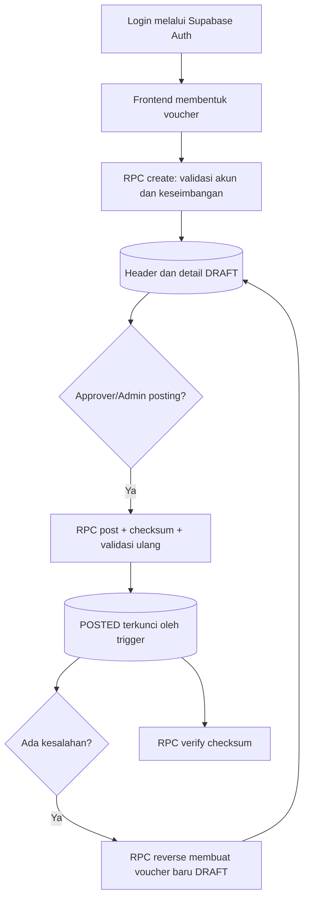

# Soal 3.2 — Mekanisme Jejak Audit dan Immutability

## Tujuan dan masalah versi simulasi

Versi awal aplikasi menyimpan riwayat di variabel JavaScript, sehingga hilang ketika halaman ditutup dan dapat dimanipulasi melalui browser. Validasi UI saja bukan batas keamanan. Implementasi ini memindahkan penyimpanan dan aturan integritas ke PostgreSQL di Supabase.

## Rancangan

Frontend menggunakan Supabase Auth dan memanggil fungsi PostgreSQL melalui RPC. `auth.uid()` menjadi sumber identitas. Fungsi RPC dan trigger melakukan pemeriksaan ulang di database. RLS membatasi pembacaan transaksi; pengguna tidak diberi izin DML langsung pada tabel.

## Penguncian `POSTED`

Trigger menolak UPDATE dan DELETE pada header `POSTED`, dan menolak INSERT, UPDATE, serta DELETE atas detailnya. Trigger juga memeriksa otorisasi approver, keberadaan detail, keseimbangan, dan checksum saat transisi `DRAFT` ke `POSTED`. Foreign key menggunakan `ON DELETE RESTRICT`; tidak ada cascade yang dapat menghapus detail. Perubahan status langsung oleh klien tidak tersedia karena hak UPDATE dicabut.

## Reversing entry

Jurnal asal dipertahankan. RPC membentuk voucher baru berstatus `DRAFT`, menukar debit dan kredit setiap baris, serta mengisi `reverses_id`. Kunci transaksi pada jurnal asal dan unique partial index mencegah dua reversal untuk jurnal yang sama. Reversal harus menjalani posting yang sama.

Contoh jurnal awal:

| Akun | Debit | Kredit |
|---|---:|---:|
| Beban Listrik (5-3100) | Rp1.500.000 | Rp0 |
| Bank BCA Operasional (1-1120) | Rp0 | Rp1.500.000 |

Reversing entry:

| Akun | Debit | Kredit |
|---|---:|---:|
| Beban Listrik (5-3100) | Rp0 | Rp1.500.000 |
| Bank BCA Operasional (1-1120) | Rp1.500.000 | Rp0 |

## Metadata dan checksum

- `created_by`: UUID pengguna dari `auth.uid()`, bukan nilai dari form.
- `created_at`: `TIMESTAMPTZ DEFAULT now()` dari database.
- `posted_by` dan `posted_at`: identitas dan waktu saat approver melakukan posting.
- `hash_checksum`: SHA-256 atas representasi JSONB kanonis berisi nomor/tanggal voucher, penerima, keterangan, `created_by`, `created_at` UTC, `reverses_id`, akun, deskripsi baris, debit, dan kredit. Baris diurutkan secara konsisten; nominal menggunakan NUMERIC yang dinormalisasi.

RPC verify menghitung ulang checksum dan membandingkannya dengan checksum tersimpan. Hash membantu mendeteksi perubahan, tetapi bukan pengganti kontrol akses dan tidak tahan terhadap pemilik database yang dapat mengganti data beserta hashnya.

## Alur backend

1. Pengguna terautentikasi mengirim data melalui RPC create.
2. Fungsi memeriksa role, kelengkapan, akun, nominal, dan kesamaan total debit/kredit.
3. Header/detail dan hash disimpan dalam satu transaksi database sebagai `DRAFT`.
4. Approver/admin memanggil RPC posting; database mengambil lock, memvalidasi ulang isi dan checksum, lalu menandai header `POSTED`.
5. Trigger mengunci header/detail pada semua jalur DML.
6. Koreksi dilakukan oleh approver/admin melalui reversal baru yang tetap `DRAFT`.
7. Pemilik voucher atau approver/admin dapat meminta verifikasi checksum.

## Hubungan dengan jawaban akademik

Implementasi memenuhi rancangan penguncian transaksi final, storno, metadata, checksum SHA-256, dan pengujian. Perbedaan dari contoh konseptual adalah aturan utama diletakkan di PostgreSQL Supabase dan frontend menggunakan RPC, bukan mempercayai validasi sisi klien.

## Batasan

- Project Supabase dan akun Auth belum tersedia/terkonfigurasi pada workspace.
- Penetapan role dilakukan pengelola project; belum ada alur administrasi role di UI.
- RLS membatasi pemilik ke voucher sendiri, sementara approver/admin dapat membaca seluruh voucher.
- Belum ada hash chain; checksum hanya membuktikan konsistensi terhadap hash yang tersimpan.
- Pemilik project, pemilik tabel, dan service role dapat melewati kebijakan; akses tersebut harus dibatasi dan diaudit.
- Integrasi dan SQL belum dieksekusi terhadap project Supabase aktual.
