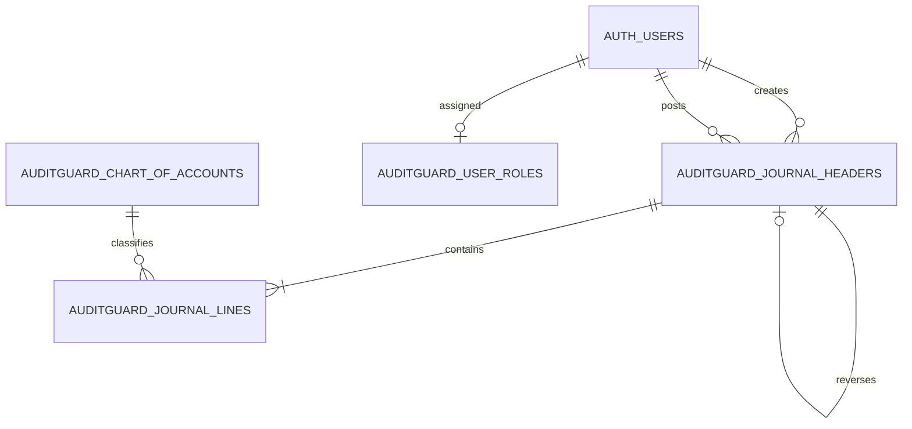

# Desain Database AuditGuard

## Relasi

## Tabel

| Tabel | Kolom penting | Keterangan |
|---|---|---|
| `auditguard_user_roles` | `user_id UUID PK → auth.users.id`, `role`, `display_name` | Dikelola admin project; tidak ada write policy untuk pengguna aplikasi. |
| `auditguard_chart_of_accounts` | `account_code TEXT PK`, `account_name TEXT` | COA; dipopulasi idempotent dari akun aplikasi. |
| `auditguard_journal_headers` | `id BIGINT identity PK`, `voucher_no UNIQUE`, `voucher_date DATE`, `payee_name`, `description`, `posting_status`, `created_by UUID`, `created_at TIMESTAMPTZ`, `hash_checksum TEXT`, `reverses_id`, `posted_by`, `posted_at` | Metadata header dan status. FK user serta self-reference memakai `ON DELETE RESTRICT`. |
| `auditguard_journal_lines` | `id BIGINT identity PK`, `journal_id FK`, `account_code FK`, `description`, `debit NUMERIC(18,2)`, `credit NUMERIC(18,2)` | Baris detail; header tidak dapat dihapus dengan cascade. |

## Constraint dan integritas

- Nomor voucher unik; status hanya `DRAFT`/`POSTED`.
- Debit/kredit non-negatif dan satu baris tidak boleh bernilai nol pada kedua sisi.
- Foreign key memastikan akun, header, dan identitas pengguna valid.
- Header `POSTED` wajib mempunyai metadata posting; header `DRAFT` tidak.
- Unique partial index mengizinkan paling banyak satu `reverses_id` untuk satu jurnal asal.
- Fungsi RPC memeriksa baris, COA, jumlah debit/kredit, dan batas nominal sebelum menyimpan.
- Trigger menolak perubahan header/detail final dan memvalidasi transisi posting.
- Operasi RPC berjalan sebagai transaksi PostgreSQL atomik.

## Fungsi dan trigger

- `auditguard_create_journal`: membuat draft, metadata, detail, checksum.
- `auditguard_update_draft`: mengubah draft milik pembuat atau approver/admin dengan validasi ulang.
- `auditguard_post_journal`: posting setelah lock dan pemeriksaan keseimbangan/checksum.
- `auditguard_reverse_journal`: membentuk reversal baru secara atomik.
- `auditguard_verify_journal`: menghitung ulang hash sesuai hak akses.
- `auditguard_checksum`: representasi kanonis, menggunakan `extensions.pgcrypto` SHA-256.
- `auditguard_protect_header` / `auditguard_protect_line`: trigger immutability.
- `auditguard_has_role`: pemeriksaan role melalui `auth.uid()`.

## RLS dan hak akses

RLS aktif pada seluruh tabel. Pengguna terautentikasi hanya dapat membaca peran sendiri dan voucher miliknya. Approver/admin dapat membaca semua voucher. COA dapat dibaca pengguna terautentikasi. `INSERT`, `UPDATE`, dan `DELETE` tabel dicabut dari `anon` dan `authenticated`; mutasi dilakukan melalui RPC yang memvalidasi identitas/role. Fungsi sensitif mencabut execute dari `PUBLIC`/`anon` dan memberikan execute terbatas kepada `authenticated`.

## Metadata dan checksum

`created_by` diisi dari JWT Supabase melalui `auth.uid()`, `created_at` dari default waktu PostgreSQL, bukan input frontend. Hash memasukkan data voucher, metadata identitas/waktu, tautan reversal, dan seluruh detail jurnal; checksum diperbarui hanya oleh operasi draft yang tervalidasi, kemudian diverifikasi sebelum posting dan melalui endpoint verify.

## Migrasi

Migrasi [001_auditguard_schema_and_controls.sql](../supabase/migrations/001_auditguard_schema_and_controls.sql) membuat tabel ber-prefiks khusus untuk menghindari benturan dengan `journal_headers` prototipe lama. Migrasi belum dijalankan. Tidak ada migrasi otomatis maupun perintah penghapusan tabel/data.
